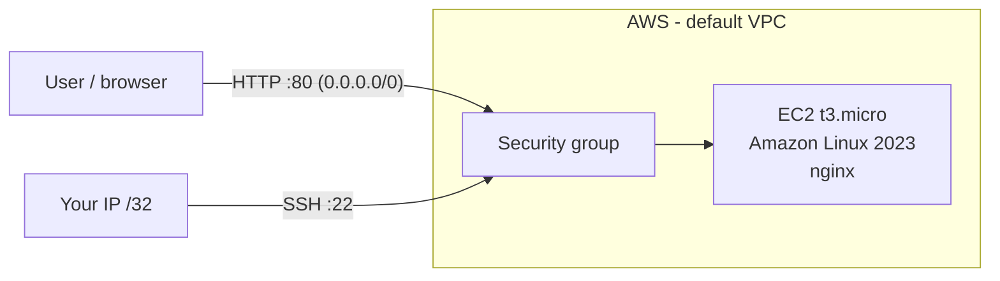

# terraform-aws-ec2-nginx

First project in a series for practicing Infrastructure as Code, with each project increasing in difficulty.

It deploys an Amazon Linux 2023 EC2 instance that installs nginx on first boot, behind a security group that exposes HTTP to the internet and SSH to a single IP only.

## Architecture



**Resources created (6):**

| Resource | Purpose |
|---|---|
| `aws_instance` | Server with nginx installed via `user_data` |
| `aws_key_pair` | Public key for SSH access |
| `aws_security_group` | Instance firewall |
| `aws_vpc_security_group_ingress_rule` ×2 | SSH (22) from your IP, HTTP (80) from the internet |
| `aws_vpc_security_group_egress_rule` | Outbound internet access (to download packages) |

## Best practices applied

- **Standard layout:** `versions.tf`, `providers.tf`, `variables.tf`, `main.tf`, `outputs.tf`.
- **Pinned versions** for Terraform and the provider, with `.terraform.lock.hcl` committed.
- **Validated variables:** types, `validation` blocks, and no default for values the deployer must choose (the SSH CIDR).
- **Dynamic AMI** through a `data` source instead of a hardcoded `ami-xxxx`.
- **Consistent tags and naming:** common tags (`Owner`, `Team`, `Environment`, `Project`, `ManagedBy`) through `default_tags` on the provider, and all resource names centralized in `locals.names` with a `<project>-<environment>` prefix. Each resource only sets its own `Name` tag, including the root EBS volume.
- **Security:** IMDSv2 enforced, encrypted root volume, SSH restricted to one IP, only the **public** key is uploaded.
- **No secrets in the repo:** state, `*.tfvars` and private keys are in `.gitignore`.

## Requirements

- [Terraform](https://developer.hashicorp.com/terraform/install) >= 1.6
- [AWS CLI](https://docs.aws.amazon.com/cli/latest/userguide/getting-started-install.html) with credentials configured (`aws sts get-caller-identity` must work)
- An SSH key pair

## Usage

**1. Generate the SSH key** (the private key stays on your machine only):

```bash
ssh-keygen -t ed25519 -f nginx-server.key -N ""
```

**2. Set the variables:**

```bash
cp terraform.tfvars.example terraform.tfvars
curl https://checkip.amazonaws.com   # your public IP
```

Edit `terraform.tfvars` and set:

- `owner` and `team`: used for the `Owner` and `Team` tags.
- `allowed_ssh_cidr`: your IP with `/32`, e.g. `181.10.20.30/32`.

**3. Deploy:**

```bash
terraform init
terraform plan -out=tfplan
terraform apply tfplan
```

**4. Test** (wait 1-2 minutes for nginx to be installed):

```bash
terraform output nginx_url      # open it in a browser, using http:// (not https)
terraform output ssh_command    # command to connect via SSH
```

**5. Destroy** when you are done, to avoid costs:

```bash
terraform destroy
```

## Variables

| Name | Description | Default |
|---|---|---|
| `aws_region` | AWS region | `us-east-2` |
| `aws_profile` | AWS CLI profile (`null` = default credentials) | `null` |
| `owner` | Owner of the resources (`Owner` tag) | **required** |
| `team` | Team responsible for the resources (`Team` tag) | **required** |
| `project` | Project name: `Project` tag and prefix for AWS resource names | `iac01` |
| `environment` | `dev` or `prod` | `dev` |
| `instance_type` | `t3.micro` or `t3.small` | `t3.micro` |
| `ssh_public_key_path` | Path to the SSH public key | `nginx-server.key.pub` |
| `allowed_ssh_cidr` | IP allowed to connect via SSH (`x.x.x.x/32`) | **required** |
| `allowed_http_cidr` | CIDR allowed to connect via HTTP | `0.0.0.0/0` |

## Outputs

`instance_id`, `ami_id`, `public_ip`, `nginx_url`, `ssh_command`.

## Costs

`t3.micro` is eligible for the AWS free tier. Outside of it, it costs a few cents per hour, so run `terraform destroy` when you are done.

## Roadmap

This project is intentionally simple. These are the improvements planned for the next iterations, roughly in order of difficulty:

- [ ] **CI with GitHub Actions:** run `terraform fmt -check`, `terraform validate`, `tflint` and `checkov` on every push.
- [ ] **Remote state:** S3 backend with state locking instead of local state.
- [ ] **Dedicated VPC:** custom VPC with public and private subnets instead of the default VPC.
- [ ] **Modules and environments:** extract the EC2 setup into a reusable module and add separate `dev` / `prod` environments.
- [ ] **SSM Session Manager:** replace SSH access, removing open port 22 and key management.
- [ ] **Load balancing and HTTPS:** Application Load Balancer + Auto Scaling Group, with TLS certificates from ACM.
